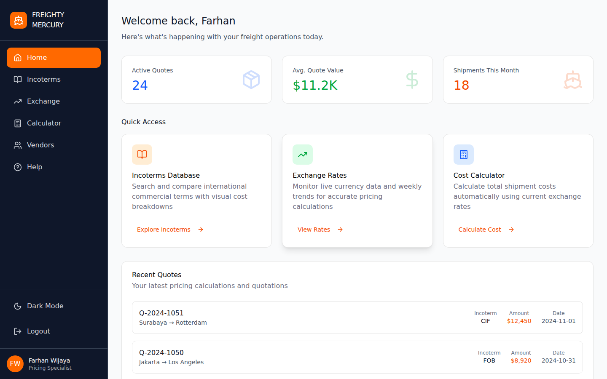
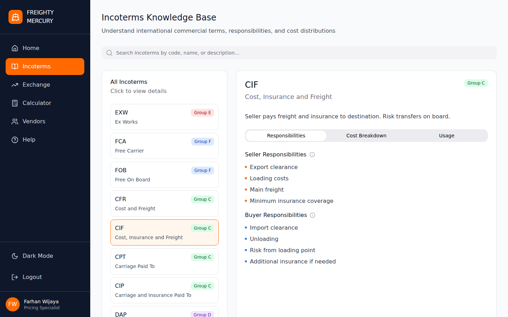
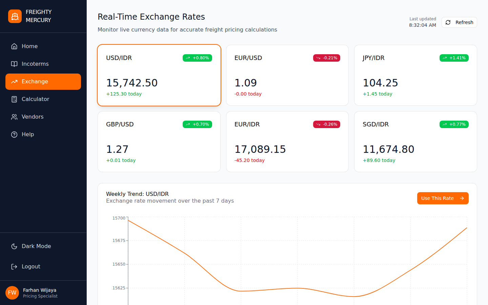
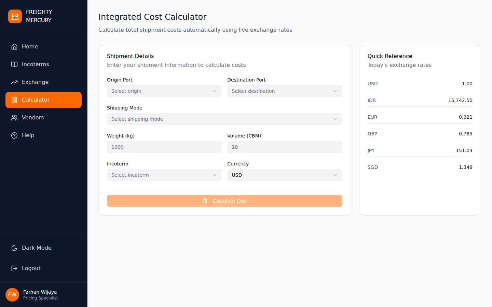
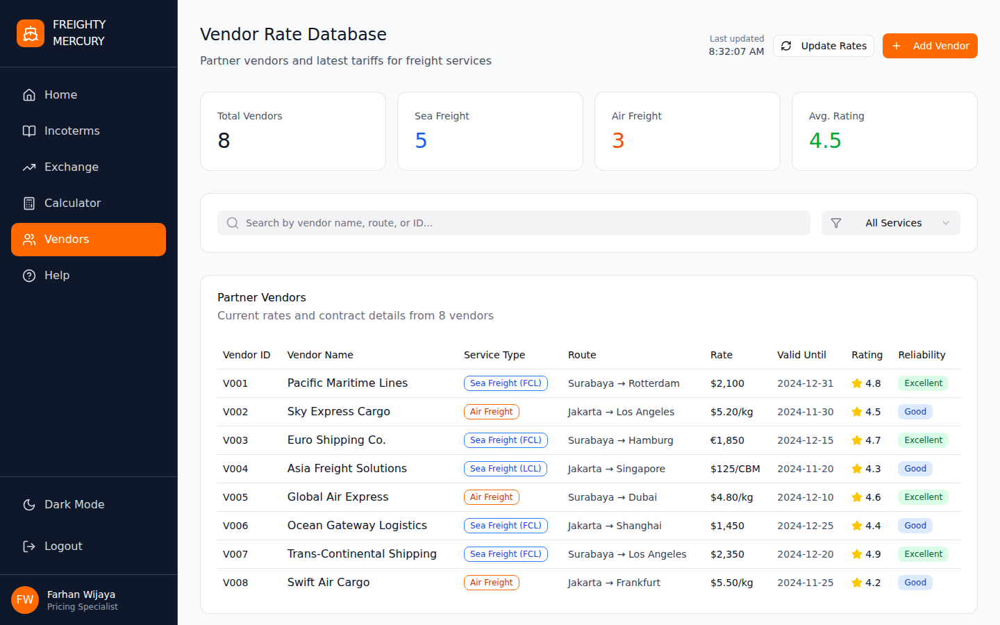
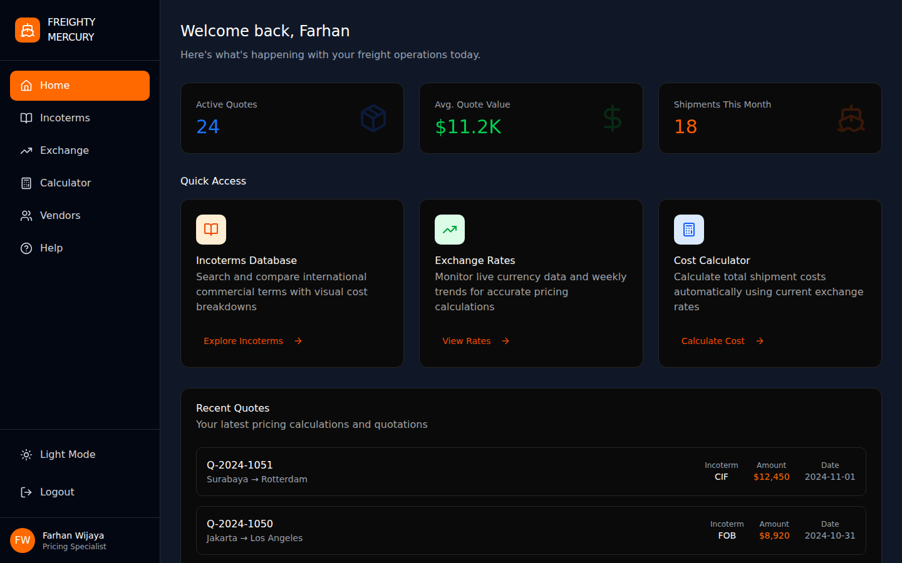
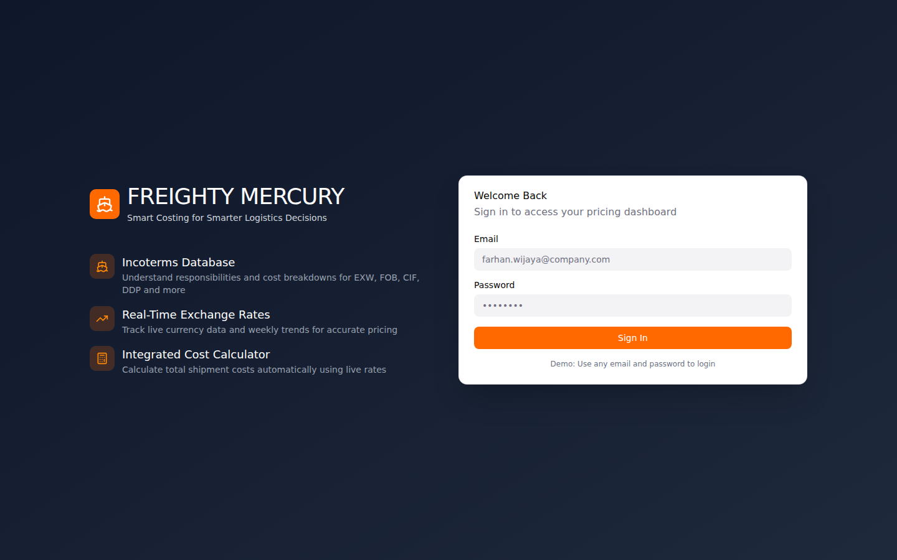

# FREIGHTY MERCURY

**Smart costing for smarter logistics decisions.**

A freight pricing web app that lets users update vendor pricing in real time, much like exchange rates. It helps logistics teams keep quotes accurate, compare Incoterms, and calculate the total cost of a shipment in one place.

🔗 **Live demo:** https://freighty-mercury-git-main-fkriyid.vercel.app/

> **Demo login:** any email and password works.

## Screenshots

<p align="center">
  
</p>

| Incoterms database | Exchange rates |
| :---: | :---: |
|  |  |

| Cost calculator | Vendor database |
| :---: | :---: |
|  |  |

| Dark mode | Login |
| :---: | :---: |
|  |  |

## Features

- **Dashboard**: at-a-glance view of active quotes, average quote value, monthly shipments, and recent quotations.
- **Incoterms database**: search and compare terms such as EXW, FOB, CIF and DDP, with a clear breakdown of who is responsible for which cost.
- **Exchange rates**: currency dashboard with weekly trend charts to support accurate pricing.
- **Cost calculator**: calculates total shipment cost automatically using current exchange rates.
- **Vendor database**: keep vendor information and pricing organized in one place.
- **Help page**: quick guidance on using the app.
- **Dark mode**: preference is saved in the browser.
- **Accessible UI**: built with Radix UI / shadcn components.

> **Note:** This is a front-end demo. All data (quotes, vendors, exchange rates) is sample data and there is no backend.

## Tech stack

| Area | Tools |
| --- | --- |
| Framework | React 18, TypeScript |
| Build tool | Vite |
| Styling | Tailwind CSS v4 |
| UI components | Radix UI, shadcn/ui |
| Charts | Recharts |
| Icons | Lucide React |
| Design | Figma Make |
| Hosting | Vercel |

## Getting started

**Requirements:** [Node.js](https://nodejs.org) 18 or newer.

```bash
# 1. Clone the repository
git clone https://github.com/fkriyid/Freighty-Mercury.git
cd Freighty-Mercury

# 2. Install dependencies
npm install

# 3. Start the dev server
npm run dev
```

Open http://localhost:5173 and sign in with any email and password.

### Other commands

```bash
npm run build     # production build in /dist
npm run preview   # preview the production build locally
```

## Project structure

```
src/
├── app/
│   ├── App.tsx                  # App shell, login state, page switching
│   └── components/
│       ├── LoginPage.tsx
│       ├── Sidebar.tsx
│       ├── DashboardOverview.tsx
│       ├── IncotermsPage.tsx
│       ├── ExchangeDashboard.tsx
│       ├── CostCalculator.tsx
│       ├── VendorDatabase.tsx
│       ├── HelpPage.tsx
│       └── ui/                  # shadcn/ui components
├── styles/                      # Tailwind and theme CSS
└── main.tsx
```

## Deployment

- **Vercel / Netlify:** import the repo. Framework preset is Vite, build command `npm run build`, output directory `dist`.
- **GitHub Pages:** Settings → Pages → Source: *GitHub Actions* (requires the workflow in `.github/workflows`).

## Roadmap

- [ ] Connect exchange rates to a live API
- [ ] Add a backend and real authentication
- [ ] Export quotes to PDF
- [ ] Persist vendor data in a database

## Credits

- UI components from [shadcn/ui](https://ui.shadcn.com/) (MIT license)
- Icons from [Lucide](https://lucide.dev/)
- Designed and prototyped in Figma Make

## Author

**fkriyid** · [GitHub](https://github.com/fkriyid)
